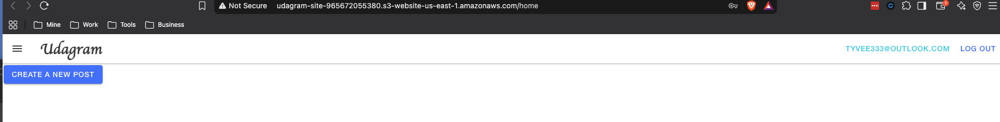
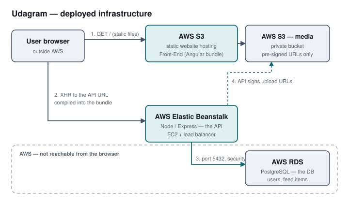
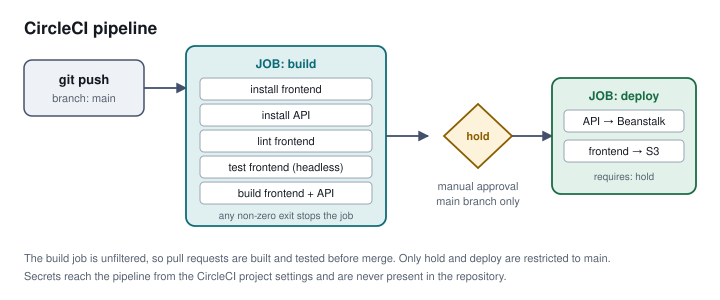

# Udagram — Hosting a Full Stack Application

[](https://dl.circleci.com/status-badge/redirect/gh/tyvee1/nd0067-c4-deployment-process-project-starter/tree/main)

A full stack image-sharing application deployed to AWS with a CircleCI
pipeline. The Angular/Ionic frontend is served as static files from S3, the
Node/Express API runs on Elastic Beanstalk, and application data lives in an
RDS PostgreSQL instance.

**Live application:** http://udagram-site-965672055380.s3-website-us-east-1.amazonaws.com



---

## Running this yourself

These commands work from a clean extraction of this archive with **no AWS
credentials**. They cover everything a reviewer needs to verify the code,
the build and the tests. Only deployment requires credentials.

### Requirements

| Tool | Version | Note |
| --- | --- | --- |
| Node.js | v14.15 as specified by the course; **any version from v14 to v22 works here** | see "A note on Node versions" below |
| npm | ships with Node | |

### Install, lint, test, build

```bash
# from the root of this archive
npm run frontend:install     # installs with -f; peer warnings are expected
npm run api:install

npm run frontend:lint        # expect: "All files pass linting."
npm test                     # expect: 13 specs, 0 failures
npm run build                # builds both applications
```

`npm run build` produces `udagram/udagram-frontend/www/` (the static site that
is uploaded to S3) and `udagram/udagram-api/www/` (the API bundle that is
deployed to Elastic Beanstalk).

### A note on Node versions

The course specifies Node v14.15. Angular 8 builds on webpack 4, which hashes
with MD4; OpenSSL 3 — bundled with Node 17 and later — refuses MD4 by default,
so a build on a modern Node fails with `ERR_OSSL_EVP_UNSUPPORTED`. The flag
that re-enables it does not exist on Node 14.

Rather than require a specific Node version, the build scripts route through
`scripts/node-compat.js`, which adds the flag only on the versions that need
it. **No action is required** — `npm run build` works on Node 14 and on Node 22
alike. The script prints which path it took.

### Running the API locally

The API needs a PostgreSQL database and the environment variables listed in
`udagram/set_env.sh`. That file ships as a template with no values in it: real
credentials are configured in CircleCI and in the Elastic Beanstalk
environment, not committed here.

```bash
cp udagram/set_env.sh udagram/set_env.local.sh   # fill in your own values
source udagram/set_env.local.sh
npm run api:start                                # http://localhost:8080/api/v0/feed
```

---

## Verifying specific requirements

Some obvious checks return misleading answers on this repository. Each command
below is the one that gives the correct answer, with what it should print.

**No hard-coded credentials.** `set_env.sh` ships as a value-free template, so
every `export` line ends with `=`:

```bash
grep -c '=$' udagram/set_env.sh
# expect: a count equal to the number of export lines — no values present
```

**The pipeline runs on the `main` branch.** The branch filter in the config
must match the branch this repository uses:

```bash
grep -A3 'branches:' .circleci/config.yml
# expect: "- main"
```

**The dev/production split is intact.** The two environment files must NOT
carry the same `apiHost`, or production configuration has leaked into the
development build:

```bash
grep apiHost udagram/udagram-frontend/src/environments/environment*.ts
# expect: environment.ts -> localhost, environment.prod.ts -> the Beanstalk URL
```

**Project-level scripts exist for tests and builds**, as distinct from the
per-application ones:

```bash
node -p "Object.keys(require('./package.json').scripts).join(' ')"
# expect: the list to include both "test" and "build"
```

---

## Architecture



See [`docs/Infrastructure_description.md`](docs/Infrastructure_description.md)
for the AWS services and how they are configured.

## Pipeline



See [`docs/Pipeline_description.md`](docs/Pipeline_description.md) for each
stage and what it does.

## Documentation

| Document | Covers |
| --- | --- |
| [Infrastructure_description.md](docs/Infrastructure_description.md) | RDS, Elastic Beanstalk, S3, networking and IAM |
| [Pipeline_description.md](docs/Pipeline_description.md) | Every job and step in the CircleCI config |
| [Application_dependencies.md](docs/Application_dependencies.md) | What each application depends on and why |

## Author

Tyrone G. Verdell
