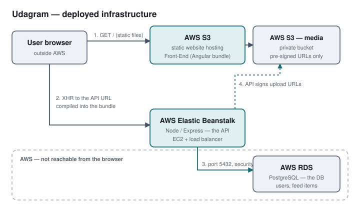

# Infrastructure description

The deployed system uses three AWS services. This document covers how each is
configured and why, including the parts that are not visible from the code.

## AWS RDS — PostgreSQL

Stores user credentials and feed item metadata.

| Setting | Value | Reason |
| --- | --- | --- |
| Engine | PostgreSQL | The API uses Sequelize with the `postgres` dialect. |
| Instance class | `db.t3.micro` | Free-tier eligible and sufficient for this workload. |
| Initial database name | `postgres` | RDS creates no database unless one is named; omitting it produces a connection that authenticates and then fails to find a database. |
| Public access | Yes | Required so the application can be run locally against the same instance during development. |
| Port | 5432 | Default. |

The API never constructs a connection string in source. Every value is read
from the environment through `udagram/udagram-api/src/config/config.ts`, which
is the single place configuration enters the application.

**Production note.** Public accessibility is a development convenience. In a
production deployment the inbound rule on port 5432 would be scoped to the
security group of the Elastic Beanstalk environment rather than to a CIDR, so
the database is reachable by the application and by nothing else.

## AWS Elastic Beanstalk — the API

Runs the Node/Express API.

| Setting | Value | Reason |
| --- | --- | --- |
| Platform | Node.js on Amazon Linux 2023 | The Node 14 / Amazon Linux 2 branch named in the course material was retired by AWS in October 2024 and is no longer offered. The application runs unmodified on a current branch. |
| Instance | `t2.micro` | Read from the deployed environment, not from the course instructions. The instructions name `t2.medium`; what is actually running is what this table reports, because a document that disagrees with the console is worse than one that says less. |
| Environment type | LoadBalanced, `classic` load balancer, Auto Scaling min 1 / max 4 | Also read from the environment. |
| Environment properties | `POSTGRES_*`, `AWS_*`, `JWT_SECRET`, `URL` | Supplied to the process at start. None of these values exist in the repository. |

Beanstalk runs `npm install --production` and then `npm start` on deployment.
`Procfile` declares the web process.

## AWS S3 — the frontend

Hosts the built Angular application as a static website.

| Setting | Value | Reason |
| --- | --- | --- |
| Bucket | `udagram-site-965672055380` | |
| Static website hosting | Enabled, `index.html` as both index and error document | A single-page application routes client-side, so unmatched paths must return the shell rather than an error. |
| Object Ownership | Bucket owner enforced — ACLs disabled | The S3 default for buckets created since April 2023, and left alone deliberately. The starter's deploy script passed `--acl public-read`, which such a bucket rejects outright with `AccessControlListNotSupported`, so the upload failed on every object. The flag was removed rather than ACLs re-enabled: the bucket policy below already grants public read, and keeping both would mean every future object needed the correct ACL *as well as* being covered by the policy — an object uploaded without one is silently unreadable while the policy suggests otherwise. One place decides who can read the site. |
| Bucket policy | `s3:GetObject` for `Principal: "*"` | **Read only.** A policy granting `s3:*` to all principals would also permit `PutObject`, `DeleteObject` and `PutObjectAcl` to any anonymous caller, which allows the site to be replaced or deleted. Static hosting needs exactly one of those four actions. |

## How the services communicate

The browser loads static files from S3. The JavaScript bundle then calls the
Elastic Beanstalk API directly over HTTP, using the URL compiled into the
production build. The API reaches RDS over port 5432 inside AWS. The browser
never contacts RDS.

Because the frontend is a static bundle with no server-side process, its API
URL is a **build-time** constant rather than a runtime setting: changing which
API it points at requires a rebuild and redeploy, not a configuration change.

## Secrets

No credential appears in this repository. `udagram/set_env.sh` ships as a
template with empty values, documenting which variables are required. Real
values are configured in two places:

- **CircleCI project environment variables**, for the pipeline.
- **Elastic Beanstalk environment properties**, for the running API.
