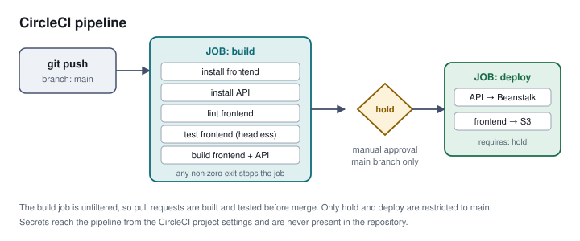

# Pipeline description

The pipeline is defined in `.circleci/config.yml` and runs on every push.



## Orbs

| Orb | Purpose |
| --- | --- |
| `circleci/node` | Installs a known Node version on the runner. |
| `circleci/aws-cli` | Installs and configures the AWS CLI from the project's environment variables. |
| `circleci/aws-elastic-beanstalk` | Installs the EB CLI for the deploy job. |

Each orb is pinned to an exact version. An unpinned orb is third-party code
that can change between runs while holding the pipeline's credentials.

## Job: `build`

Runs on every branch, so a pull request is checked before it is merged.

| Step | Command | What it proves |
| --- | --- | --- |
| Install frontend | `npm run frontend:install` | Dependencies resolve. |
| Install API | `npm run api:install` | Dependencies resolve. |
| Lint frontend | `npm run frontend:lint` | The code meets the project's tslint configuration. |
| Test frontend | `npm test` | The 13 unit specs pass, in a headless browser. |
| Build frontend | `npm run frontend:build` | A production bundle is produced. |
| Build API | `npm run api:build` | The TypeScript compiles and the deployable archive is produced. |

The order matters: install precedes everything, lint and test precede build,
and a failure at any step stops the job. A step's exit code is the only signal
the pipeline reads — a step that printed an error and exited zero would be
reported as success.

### Running the unit tests on a CI runner

The committed `karma.conf.js` launches `Chrome` and watches for changes, which
cannot work on a runner with no display and no browser. The test job uses a
headless launcher with `--no-sandbox`, which containers require.

## Job: `hold`

A manual approval gate, filtered to the `main` branch. It does no work; it
waits for a person. Its presence is what makes this pipeline **continuous
delivery** rather than continuous deployment: every passing build produces a
deployable artifact, and a human decides when it ships.

The branch filter and the repository's default branch must agree. If they do
not, this job never triggers, `deploy` never runs because it requires `hold`,
and the pipeline still reports success — a green build that deploys nothing.

## Job: `deploy`

Runs only after `hold` is approved.

| Step | What it does |
| --- | --- |
| `aws-cli/setup` | Configures the CLI from the project's environment variables. |
| `eb/setup` | Installs the Elastic Beanstalk CLI. |
| Deploy API | Builds and deploys the API to the Beanstalk environment. |
| Deploy frontend | Builds the production bundle and syncs it to S3. |

## Secrets

The pipeline reads `AWS_ACCESS_KEY_ID`, `AWS_SECRET_ACCESS_KEY`,
`AWS_DEFAULT_REGION` and the `POSTGRES_*` and `JWT_SECRET` values from the
CircleCI project's environment variables. None is present in this repository.

**Production note.** Long-lived access keys stored in a CI provider are a
standing credential: anyone who obtains them has them until they are rotated.
A production pipeline would federate with OIDC instead, so the provider holds
no credential at all and each run receives short-lived tokens scoped to the
repository and branch.

## Database TLS, and a trade-off that belongs here rather than in code

The API connects to RDS over TLS, and the Sequelize configuration sets
`rejectUnauthorized: false`. That is a deliberate choice with a cost, so it is
written down instead of sitting unexplained in source.

RDS PostgreSQL 18's default parameter group sets `rds.force_ssl=1`. The server
therefore offers `hostssl` only, and an unencrypted connection is refused at
authentication:

```
no pg_hba.conf entry for host "...", user "postgres",
database "postgres", no encryption          (SQLSTATE 28000)
```

The failure is worth describing because of how it presents. The instance
reports `available` throughout, the security group permits the connection, and
a client that happens to default to TLS authenticates successfully — so the
database looks healthy from every direction except the one the application
uses. Nothing is wrong with the database; the application was asking for a
transport the server does not accept.

`require: true` fixes that: the connection is encrypted. `rejectUnauthorized:
false` additionally skips verification of the server's certificate, which means
the channel is private but the endpoint is trusted rather than proven. The
honest alternative is to ship Amazon's RDS CA bundle and verify against it,
which requires that bundle to be present on every host that connects —
developer machines, the Beanstalk instance, and any reviewer's laptop — and to
be kept current as Amazon rotates it. For a coursework deployment reaching one
database inside one account, that cost is not justified; for anything handling
real data it is, and this is the line that would change.

## Deployed environment properties

The same database settings must exist as Beanstalk environment properties or
the deployed API fails exactly as above while the environment reports Green —
a healthy platform in front of an application that cannot start. `AWS_PROFILE`
is deliberately **not** among them: the instance has no credentials file and
uses its instance role, so naming a profile sends the SDK looking for a file
that does not exist.

## Deploy user permissions

The deploy user's permissions were attached from AWS managed policies —
`AmazonS3FullAccess` and `AdministratorAccess-AWSElasticBeanstalk` — rather
than an inline policy scoped to this project's two buckets and one
environment. The narrower policy was attempted first and refused: this is an
AWS Academy Learner Lab account, which permits `iam:CreateUser` and denies
`iam:PutUserPolicy`. The result is a CI credential wider than the work
requires, which is recorded here because a reader comparing the policy to the
pipeline would otherwise reasonably assume it was chosen.
